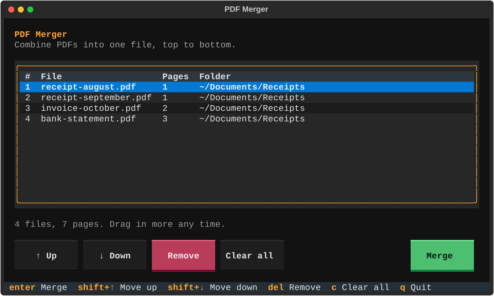
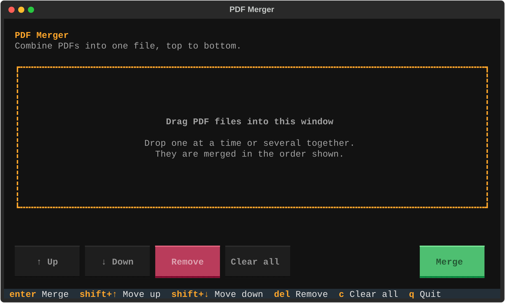
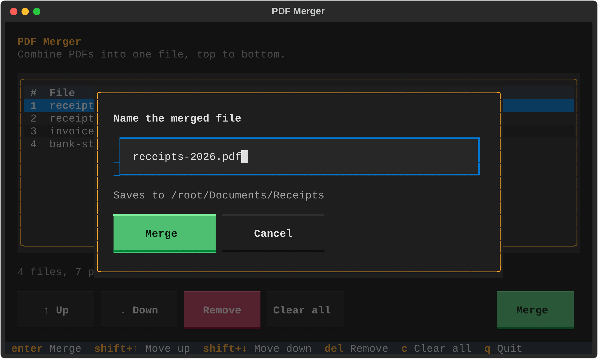
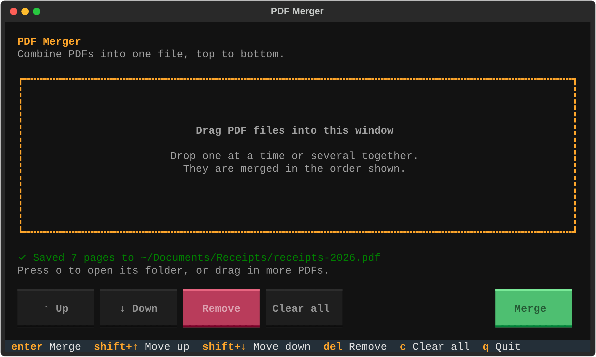

# PDF Merger

A small terminal app that combines PDFs into one file. Drag your PDFs into the window, put them in order, press Enter.



- **Drag and drop** files straight from Finder or File Explorer
- **Keyboard or mouse**: every action has a key and a button
- **Safe**: your original files are never changed, and existing files are never overwritten
- **One file, no setup**: it installs what it needs the first time you run it

## Install

You need [Python](https://www.python.org/downloads/) 3.9 or newer. On Windows, tick "Add Python to PATH" in the installer.

Download [`merge_pdfs.py`](merge_pdfs.py), or clone the repo:

```
git clone https://github.com/sh-how/pdf-merger.git
cd pdf-merger
```

## Run

| macOS / Linux | Windows |
| --- | --- |
| `python3 merge_pdfs.py` | `python merge_pdfs.py` |

The first run takes a few seconds while it installs its two dependencies ([pypdf](https://pypi.org/project/pypdf/) and [Textual](https://textual.textualize.io/)). If you would rather install them yourself, run `pip install -r requirements.txt` first.

If you use [uv](https://docs.astral.sh/uv/), `uv run merge_pdfs.py` works with no setup at all.

## How to use it

### 1. Drag your PDFs into the window

Drop one file at a time or several together.



### 2. Put them in order

Files are merged from top to bottom. Select a file with the arrow keys or a click, then move it up or down.


### 3. Press Enter and name the file



### 4. Done

The merged PDF is saved in the same folder as the first file in the list. Press `o` to open that folder.



## Controls

| Action | Key | Button |
| --- | --- | --- |
| Add files | Drag them into the window | |
| Select a file | `↑` `↓` | Click a row |
| Move file up | `Shift+↑` or `u` | ↑ Up |
| Move file down | `Shift+↓` or `d` | ↓ Down |
| Remove file | `Delete` or `x` | Remove |
| Clear the list | `c` | Clear all |
| Merge | `Enter` or `m` | Merge |
| Open the output folder | `o` | |
| Quit | `q` or `Esc` | |

## Good to know

- If `merged.pdf` already exists, the new file is saved as `merged (2).pdf`.
- Pages are copied as they are, so text and image quality are unchanged.
- You can also pass files when starting the app: `python3 merge_pdfs.py a.pdf b.pdf`
- Drag and drop relies on your terminal pasting the path of a dropped file, which most terminals do (Terminal and iTerm2 on macOS, Windows Terminal, GNOME Terminal). If yours does not, paste or type the file paths instead.
- If `Shift+↑` does nothing in your terminal, use `u` and `d`.

## License

[MIT](LICENSE)
